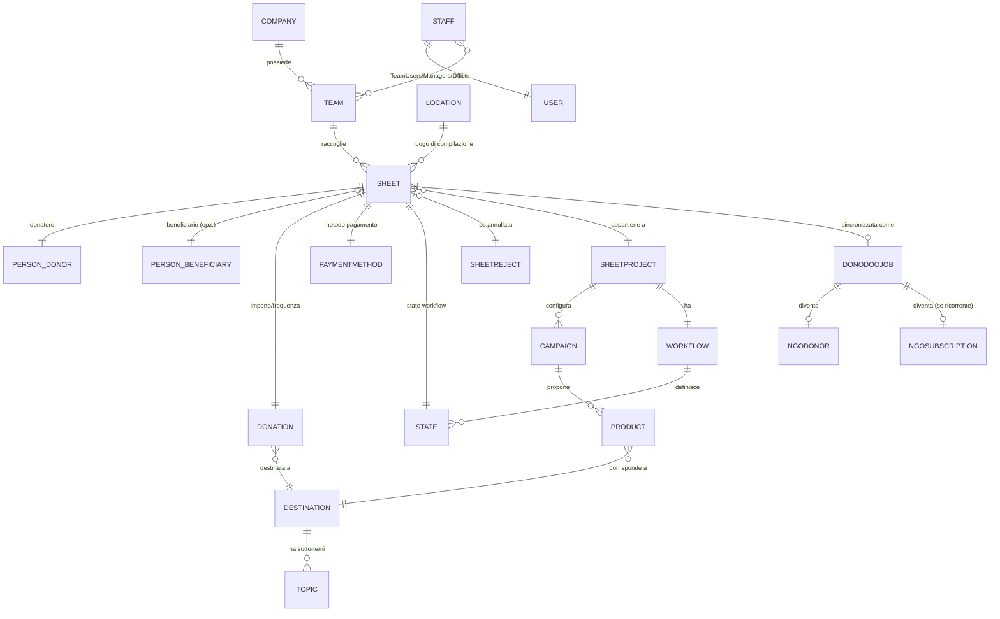

# Modello dati

## Entità principali e relazioni



## Sheet (adesione) — campi ed enum

Vedi il capitolo "Riferimento endpoint: adesioni e turni" per la forma esatta della risposta API. Qui la legenda completa degli enum.

### Frequenza donazione (`donation.frequency`)

| Codice | Significato |
|---|---|
| 0 | Una tantum (donazione singola, non ricorrente) |
| 1 | Annuale |
| 2 | Semestrale |
| 3 | Quadrimestrale |
| 4 | Trimestrale |
| 6 | Bimestrale |
| 12 | Mensile |

Il numero rappresenta le rate all'anno, non un id arbitrario: `importo annualizzato = amount × frequency` (o semplicemente `amount` se una tantum).

### Metodo di pagamento (`payment.method`)

| Codice | Significato |
|---|---|
| BW | SEPA Direct Debit (nel codice chiamato "bankwire", ma è un mandato SDD, non un bonifico manuale) |
| DD | Direct Debit (variante distinta da BW) |
| CC | Carta di credito |
| TTL | SEPA SDD gestito via canale TTL |
| POS | Pagamento fisico via POS |
| PP | PayPal |

### Sesso/tipo persona (`donor.sex`)

| Codice | Significato |
|---|---|
| M | Maschio |
| F | Femmina |
| N | Nucleo familiare |
| C | Azienda |

### Esito dello stato di workflow (`state.outcome`, uso interno per statistiche)

| Codice | Significato |
|---|---|
| -1 | Negative |
| 0 | Gross (incompleto) |
| 1 | Positive (default) |

## La distinzione "firmata" vs "attivata" vs "annullata"

Non è un unico campo enum: sono tre concetti calcolati da segnali diversi, ed è importante non confonderli quando si risponde a una domanda su quante adesioni sono in un determinato stato.

- **Firmata**: `state.checkpoint == true` e `checkpoint_date` non nulla. Significa che la scheda ha superato la validazione stringente dei dati (importo valido, mandato/carta compilati, ecc.), non necessariamente che il pagamento sia stato incassato.
- **Attivata**: nessun campo dedicato. Si deduce dall'esistenza di una transazione di pagamento riuscita (`transaction_result == 'OK'`) e/o dalla presenza di `stripe_subscription_id`/`paypal_subscription_id`, oppure dal fatto che lo stato coincide con quello configurato come "successo" per il trigger di pagamento del progetto.
- **Annullata**: `sheet.reject` non nullo (con una causale associata) — è il segnale più diretto e usato anche nel calcolo ufficiale delle statistiche interne:

```
se sheet.reject esiste:                          -> annullata
altrimenti se state.outcome == Positive:         -> completata (di fatto "attivata con successo")
altrimenti se nessuno stato o state.outcome == Gross: -> incompleta
altrimenti:                                       -> annullata
```

Le **etichette testuali** (`state.label`) che un singolo cliente usa per questi concetti sono dati di configurazione per progetto, non un enum fisso nel codice: prima di calcolare un numero su "quante firmate/attivate", verificare quali sono gli stati reali configurati per quel cliente, o chiedere direttamente all'utente cosa intende.

## Ruoli persona (riepilogo, dettaglio nel capitolo Ruoli e permessi)

| Ruolo | Determinato da |
|---|---|
| Dialogatore | Appartenenza attiva a `TeamUsers` |
| Team leader / Leader / Supervisor | Campi diretti su `Team` |
| Manager | Appartenenza attiva a `TeamManagers` |
| Backofficer | Appartenenza a `TeamOfficer` + permesso Django `sheet.add_as_another_user` |

## Soft delete e flag di validità

- `Sheet.deleted` (booleano): il manager di default (`objects`) filtra sempre `deleted=False`. Per accedere anche alle schede eliminate serve un manager alternativo non esposto dall'API pubblica.
- `Location.active`, `SheetProject.active`, `Campaign.active`, `SheetTracking.is_active`, `Destination.active`: flag booleani di attivazione, filtrati nella maggior parte delle query di default lato backend (non sempre esposti come filtro lato client, verificare caso per caso nel catalogo endpoint).
